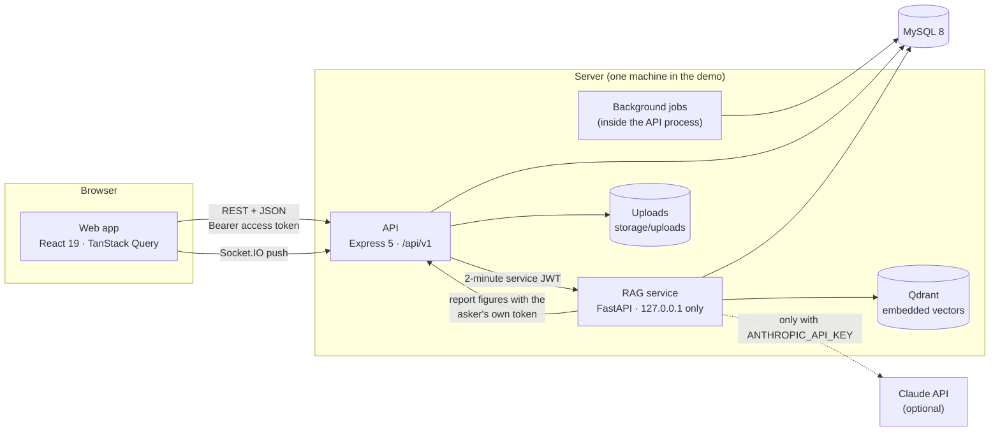
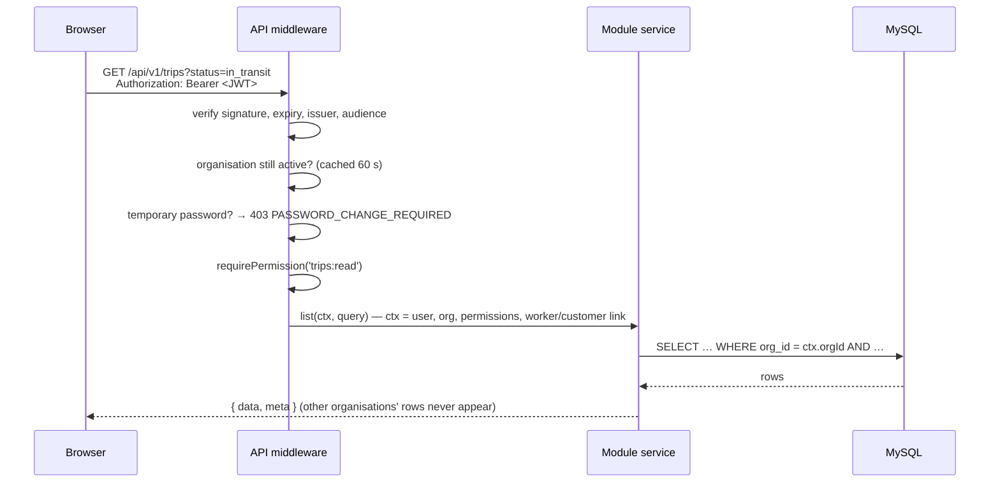

# Architecture

TransAxis is a TypeScript monorepo (npm workspaces) with one Python service. This page explains how the parts fit together, how a request travels through them, and where to look when changing something.

## Components



| Part | Folder | Role |
|---|---|---|
| Web | `apps/web` | Single-page app. Holds the access token in memory only; every screen is filtered by permission, but the API is the security boundary. |
| API | `apps/api` | All business logic and authorisation. One Express router per module under `src/modules/<area>` (routes + service). |
| Shared | `packages/shared` | Permissions, roles, enums, zod schemas and pure business rules (eligibility, trip state machine, GST, ETA). Used by both API and web, so validation messages match. |
| Database | `database` | Drizzle schema (`src/schema`), hand-reviewed SQL migrations (`migrations`), deterministic seed (`seeds`). |
| RAG | `services/rag` | Parses documents, indexes passages (Qdrant + MySQL FULLTEXT), routes questions and writes answers. See [rag.md](rag.md). |

## A request, end to end



Every service method takes the `RequestContext` first, and every query filters by `ctx.orgId`. Driver logins (`ctx.workerId`) see only their own trips and pay; customer-portal logins (`ctx.customerId`) see only their own bookings and invoices. A row from another organisation returns 404, never 403, so IDs can't be probed.

Writes that change money or state run in one database transaction together with their audit row (`audit(tx, req, …)`), so an audit entry exists exactly when the change committed.

## Sessions

```mermaid
sequenceDiagram
  participant B as Browser
  participant A as API
  B->>A: POST /auth/login {email, password}
  alt two-step sign-in on
    A-->>B: { mfaRequired, mfaToken (5 min) }
    B->>A: POST /auth/login/totp {mfaToken, code}
  end
  A-->>B: access token (15 min, memory only) + refresh cookie (httpOnly, SameSite=Strict, 14 days)
  Note over B,A: …later, a request gets 401…
  B->>A: POST /auth/refresh (cookie)
  A-->>B: new access token + rotated cookie (old one now invalid; reuse revokes the family)
```

Permissions are copied into the access token at sign-in and refresh, so a role change reaches people within 15 minutes; changing someone's roles or disabling them also revokes their refresh sessions at once.

## Background jobs

Jobs run inside the API process on intervals (`liveJobs` in `apps/api/src/app.ts`). Each run takes a lease in `job_locks`, so if several API processes run, only one does the work. **System health** shows a job as stopped when its lease lapsed more than five minutes ago.

| Job | Every | Does |
|---|---|---|
| `gps-simulator` | 10 s | Moves simulated vehicles along their routes (labelled SIMULATED) |
| `tracking-evaluator` | 30 s | Raises and clears no-signal, stop, deviation, overspeed and lateness alerts |
| `checkin-monitor` | 60 s | Flags missed driver check-ins |
| `notification-escalation` | 60 s | Escalates unacknowledged critical notifications |
| `gps-retention` | 1 h | Deletes GPS points older than `GPS_RETENTION_DAYS` |
| `document-ingest` | 15 s | Sends queued documents to the RAG service; re-queues stuck ones |

## Module map

| Module (`apps/api/src/modules`) | Mounted at | Covers |
|---|---|---|
| `auth` | `/auth` | Sign-in, two-step verification, refresh, logout, password change and reset |
| `admin` | `/admin` | People, roles, settings, expense categories, audit log, system health, tenants |
| `search` | `/search` | Global search for the Ctrl+K palette |
| `exchange` | `/exchange` | CSV export, templates and checked imports |
| `vehicles`, `workers`, `parties` | `/vehicles`, `/workers`, `/customers`, `/vendors`, … | Master data |
| `bookings`, `trips` | `/bookings`, `/trips` | Orders, assignment with eligibility rules, trip lifecycle |
| `tracking`, `safety`, `notifications` | `/tracking`, `/alerts`, `/incidents`, `/checkins`, `/notifications` | Live operations |
| `maintenance`, `finance` | `/maintenance`, `/finance`, `/reports` | Workshop, fuel, ledger, invoices, expenses, settlements, reports |
| `portal` | `/portal` | Customer self-service |
| `documents`, `ai` | `/documents`, `/ai` | Library and assistant (calls the RAG service) |
| `files`, `reference` | `/files`, `/reference` | Attachments and lookup lists |

The OpenAPI description at `/api/v1/openapi.json` (Swagger UI at `/api/v1/docs`) lists every endpoint.

## Where things are decided

- **Who may do what:** `packages/shared/src/permissions.ts` (catalogue) and `roles.ts` (defaults). The roles editor changes the database copy per organisation.
- **Business rules:** `packages/shared/src/rules/*` are pure functions with unit tests (trip and booking state machines, assignment eligibility, GST, ETA, compliance windows). Services call them and then persist.
- **Organisation thresholds:** `org_settings` (document warning window, minimum rest, maximum duty), edited under Administration → Settings.
