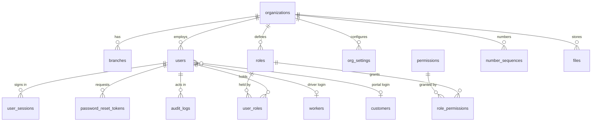
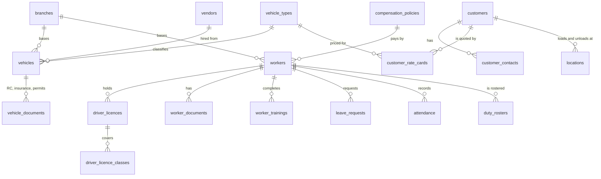
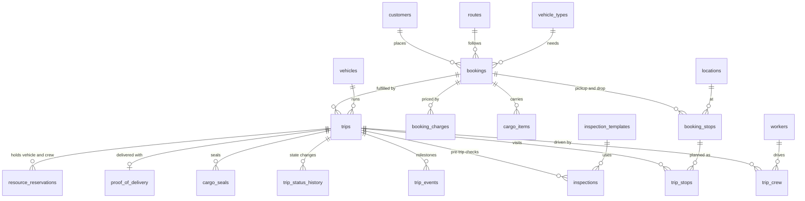
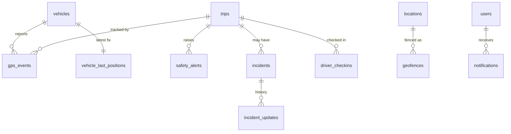
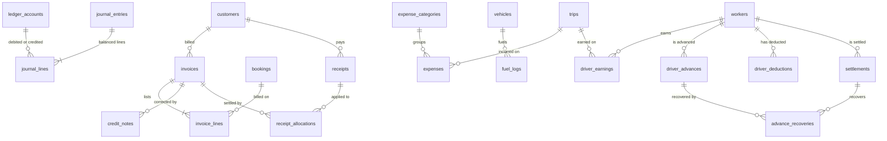
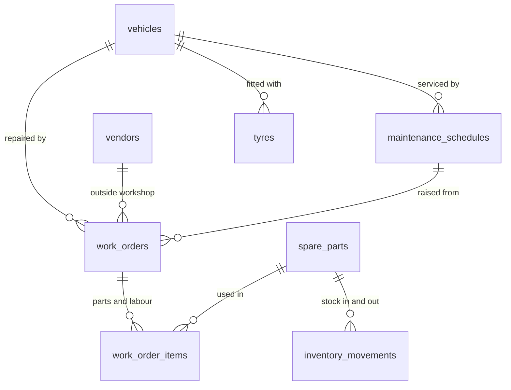
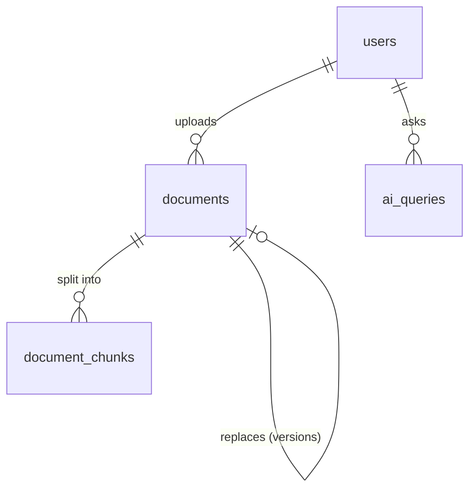

# Database

MySQL 8, InnoDB, utf8mb4. The schema is defined in `database/src/schema/*.ts` (Drizzle) and created by the SQL migrations in `database/migrations` (79 tables). Diagrams below show the main relationships per area; every business table also has an `org_id` foreign key to `organizations`, left out of the diagrams for readability.

## Conventions

- **Tenancy:** every business row carries `org_id`; every query filters by it. Unique keys are per organisation (`uq_vehicles_org_reg`, `uq_workers_org_code`, `uq_customers_org_code`, …).
- **Money:** `DECIMAL(14,2)` in rupees, computed with decimal arithmetic, never floats. Quantities such as weight and fuel have their own scales.
- **Time:** instants are stored in UTC (`DATETIME(3)`); calendar dates (`DATE`) are the organisation's local dates (`organizations.timezone`, Asia/Kolkata in the demo).
- **Numbering:** human-readable numbers such as `TRP-2026-000123` or `INV-2026-000045` come from `number_sequences`, per organisation, scope and year, assigned inside the same transaction as the row.
- **Append-only tables:** `audit_logs` and `journal_lines` have triggers that block UPDATE and DELETE. Ledger corrections are reversal entries.
- **Soft state, not deletes:** most master data is deactivated (`status`, `is_active`) rather than deleted, so history stays intact.

## Identity, access and platform

| Table | Notes |
|---|---|
| `users` | Argon2id `password_hash`; lockout counters; `must_change_password` for temporary passwords; `totp_secret_enc` (AES-256-GCM), `totp_enabled`, `totp_last_step` (replay protection); optional `worker_id` / `customer_id` links |
| `user_sessions` | Refresh sessions: only the SHA-256 of the token, a `family_id` for reuse detection, rotation and revocation times |
| `roles`, `role_permissions`, `permissions` | Built-in roles per organisation (`is_system`) plus custom roles (`custom_*`); the permission catalogue is global |
| `org_settings` | JSON values for the allowed keys (document warning days, minimum rest, maximum duty) |
| `audit_logs` | Who, what, before/after JSON, IP, browser, request ID. Append-only |
| `job_locks` | Leases that keep each background job to one runner |

## Fleet, people and customers

## Bookings and trips

`resource_reservations` stops a vehicle or person being booked on two overlapping trips; the eligibility rules in `packages/shared/src/rules/eligibility.ts` also check licences, documents, rest and duty hours.

## Live operations

## Finance

Every financial document (invoice, receipt, approved expense, fuel log, work order, earning, advance, settlement) points to the `journal_entries` row it posted. The ledger service refuses an entry whose debits and credits differ, and `journal_entries.idempotency_key` (unique per organisation, such as `fuel:812`) makes posting the same document twice impossible.

## Maintenance

## Documents and the assistant

`document_chunks.content` has a FULLTEXT index for keyword search; vectors live in Qdrant (`storage/qdrant`), keyed by chunk ID and filtered by organisation and classification.

## Migrations

| File | Adds |
|---|---|
| `0000_init_core_fleet` | Organisations, users, roles, permissions, sessions, settings, files, fleet |
| `0001_audit_append_only` | Triggers that make `audit_logs` append-only |
| `0002_operations` | People, customers, vendors, bookings, trips |
| `0003_live_ops` | GPS, alerts, incidents, check-ins, notifications |
| `0004_finance_maintenance` | Ledger, invoices, receipts, expenses, fuel, crew pay, maintenance |
| `0005_journal_append_only` | Triggers that make `journal_lines` append-only |
| `0006_documents_ai`, `0007_documents_fulltext` | Documents, passages, AI queries, FULLTEXT index |
| `0008_user_totp_step` | `users.totp_last_step` for two-step replay protection |

Apply with `npm run db:migrate`. Migrations are plain SQL, reviewed before commit; never edit one that has been applied, add a new one.
